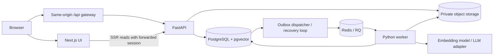

# DeliveryGap AI — implementation plan

Status: **Functional P0 implementation complete; release acceptance and P1 remain open.** Connected frontend/backend workflows cover sources, requirements, baselines, evidence, reports, bounded AI extraction, and queued hybrid change analysis. Analysis uses BM25 plus cached 1024-dimensional Neon Gateway embeddings with reciprocal-rank fusion, exact citation validation, project-lead provider consent, persisted candidate diagnostics, and bounded request decomposition with exact source offsets. A synthetic per-case evaluation runner exists, but labels await human review and the live provider path remains unverified. GitHub import, advanced source highlighting, baseline comparison UI, and optional reranking remain P1. Real Redis/RQ/S3 recovery, held-out quality evaluation, clean-stack/backup acceptance, and release gates remain open. See [current completion status](./docs/completion-work.md) and [verification ledger](./docs/phase-0-verification.md).
Latest continuation (20 October 2026): the functional frontend/backend slice was completed and locally verified across sources, requirements, baselines, extraction, analysis proposals, evidence, traceability, reports, permissions, retries, and browser workflows. Local verification: 82 backend tests passed, 7 skipped; all 13 browser tests and the production build passed. Docker/deployment work is outside the current submission scope. Live-provider quality evaluation and human-reviewed labels remain explicitly unclaimed. See the [functional handoff](./docs/frontend-backend-handoff.md), [verification ledger](./docs/completion-work.md), and [retry contract](./docs/project-creation-retries.md).  
Latest demo-readiness continuation (20 October 2026): added the local-only, API-driven ShopFlow bootstrap and supervisor walkthrough. Verification: 85 backend tests passed, 7 skipped; 13 Chromium tests passed; typecheck, lint, build, fixture validation, Ruff/format, and strict mypy passed. Docker is unavailable, so the bootstrap and real Compose demo remain unverified. See [demo readiness](./docs/DEMO_READINESS.md) and the [supervisor script](./docs/SUPERVISOR_DEMO.md).  
Prepared: 16 October 2026.  
Source of product scope: [Complete PRD](./DeliveryGap_AI_Complete_PRD.md).  
Confirmed stack: Next.js + FastAPI.  
Original planning starting point (16 October 2026): PRD only. The workspace now contains the foundation application and initial migration.

## 1. Outcome and boundaries

Build a single-workspace internal application in which an authorized reviewer can upload a scope document, approve extracted requirements, publish an immutable baseline, analyze later requests, inspect citations, record decisions, link delivery/test evidence, and export a report. The full workflow must work through the UI on synthetic data.

This plan is the preparation step requested before implementation. It creates no application code, infrastructure, accounts, or external integrations.

P0 includes authentication, project membership, document ingestion, requirements, baselines, asynchronous analysis, finding review, CSV/manual evidence, traceability, overview counts, Markdown/CSV reports, evaluation, and reproducible local operation. P1 includes GitHub read-only import, advanced source highlighting, baseline comparison UI, optional reranking, and polish. PDF reports, OCR, Jira, live meetings, billing, and automatic external actions are excluded.

Preserve the PRD's vocabulary: findings are proposals; missing evidence does not mean missing implementation; retrieval scores are not confidence probabilities. AI never approves requirements, publishes baselines, or changes reviewer decisions.

## 2. Implementation decisions

| Area | Planned choice | Reason / constraint |
|---|---|---|
| Web | Next.js App Router, TypeScript strict, React, Tailwind, shadcn/ui primitives | Accessible application UI, server rendering and focused client interactions |
| API | FastAPI, Pydantic v2, SQLAlchemy 2, Alembic, psycopg | One authoritative domain layer and migration history |
| Python | Python 3.12 initially, uv with committed lockfile | Conservative starting runtime for parsing/ML dependencies |
| JavaScript | Current compatible Node LTS, pnpm with committed lockfile | Verify package compatibility at scaffold time; pin exact resolved versions |
| Database | PostgreSQL with pgvector | Relational provenance, full-text search and embeddings in one database |
| Jobs | Redis + RQ, dedicated Linux worker container | Long processing must survive web/API request lifetimes; avoid native Windows worker assumptions |
| Storage | Private MinIO locally; S3-compatible adapter | Private originals and exports; metadata stays in PostgreSQL |
| Sessions | Backend-managed opaque session cookie, hashed tokens in DB, Argon2 passwords | Revocation and project authorization remain in FastAPI |
| Parsing | pypdf, python-docx, strict text decoding | Selectable-text PDF, DOCX, TXT and MD only |
| Embeddings | Neon AI Gateway `qwen3-embedding-0-6b`, 1024 dimensions | Shared query/document model; model name and dimensions are frozen in analysis config and embedding cache keys |
| Reranking | Optional MiniLM cross-encoder after measured retrieval baseline | Adds cost; retain only if evaluation justifies it |
| LLM | Provider protocol + deterministic fixture provider + one hosted adapter | Develop/test without secrets; hosted provider selected and configured before live inference |
| Browser data | Generated OpenAPI types, small fetch wrapper, TanStack Query for polling and mutations | No domain logic in Next.js; invalidate affected views after mutations |
| Forms | React Hook Form and Zod for client feedback; Pydantic authoritative | Consistent validation and accessible errors |
| Verification | pytest, Ruff, mypy; ESLint, tsc, focused component tests, Playwright | Test domain invariants and complete workflows |
| Deployment | Containers for web, API and worker; persistent DB/Redis/object storage | Full local demonstration is mandatory; cloud hosting is optional |

SQLAlchemy starts with synchronous sessions and explicit transaction boundaries. FastAPI blocking database endpoints use synchronous handlers; worker services use the same repository/service layer. Avoid mixing sync ORM calls into async request handlers. Reconsider async SQL only with measured need.

Choose exact framework/container versions during foundation work after compatibility checks; commit package locks and pin container/model versions. This plan does not claim current registry versions have been verified.

## 3. Runtime and authentication architecture



- Browser requests use the web origin and `/api/v1`. A thin Next.js rewrite/proxy forwards to FastAPI; production may use an ingress proxy with the same routing. Verify streaming uploads, cookies and response headers in Week 1.
- Next.js server components call the internal API URL with the incoming session cookie forwarded explicitly. Authenticated fetches use `no-store`; no sensitive document text in browser persistence or shared caches.
- FastAPI sets host-only HttpOnly cookies, Secure outside localhost, SameSite=Lax. Store only a hash of the random session token. Login rotates the token; logout, account disablement and expiry revoke access.
- Use session-bound CSRF tokens returned by a safe session endpoint and passed in a custom header for mutations. Validate Origin on unsafe requests, including login; apply a documented same-origin fallback for clients lacking Origin. Never trust arbitrary forwarded headers.
- Browser UI gating is for usability; service authorization is mandatory for every operation. Downloads and source spans require the same project membership checks.
- Admin-created users only. Workspace admin can manage projects/users; admin project bypasses are explicit and audited. Adopt the PRD actor table: only admins create projects initially; leads manage their project membership without granting workspace-admin status. The creator becomes project lead.
- Leads approve/publish/finalize findings and link reviews. Members upload, edit drafts, import artifacts and propose/manual-link evidence; their links require lead acceptance. Reviewers only read and download. Manual link creation by a lead can explicitly accept in the same audited command.
- Reject forbidden writes with 403; hide inaccessible project resources with 404. Recheck membership on each request and before queued processing starts; canceled/revoked user jobs must not bypass access controls.

## 4. Repository structure

```text
apps/
  web/                         Next.js application, UI and generated API types
  api/
    app/
      api/                     routes, schemas and dependencies
      core/                    configuration, auth, errors and logging
      db/                      models and session management
      repositories/            project-scoped persistence
      services/                domain use cases and transactions
      jobs/                    handlers, dispatch, leases and recovery
      ai/                      providers, prompts, retrieval and pipelines
      parsers/                 PDF/DOCX/text adapters and source mappings
      integrations/            CSV, optional GitHub
    alembic/
    tests/
datasets/
  synthetic_project/           ShopFlow documents, tasks, tests and expected cases
  eval/                        additional fictional projects, rubric and split manifests
scripts/                       seed, smoke and evaluation entry points
infrastructure/                Compose, Dockerfiles and local service initialization
docs/                          architecture, ADRs, API, evaluation and deployment
.github/workflows/            CI
```

Keep one backend package shared by API and workers. Avoid microservices, a second backend in Next.js, and generic repository abstractions without a concrete use case.

## 5. Database implementation and invariants

Implement schema incrementally with reversible Alembic migrations and real PostgreSQL tests; SQLite cannot substitute for pgvector, constraints and concurrency behavior.

| Migration group | Entities / additions | Required constraints |
|---|---|---|
| Identity | users, sessions, projects, project_members, audit_events | normalized unique email; explicit workspace-admin flag; unique membership; revoked/expired session checks |
| Processing | processing_jobs, job_attempts, outbox_events, idempotency_records | scoped request key + request hash; bounded attempts; unique logical outputs |
| Sources | documents, document_versions, source_spans, document_chunks, chunk_spans | unique document version; immutable original; ordered exact source mappings |
| Scope | requirements, requirement_versions, requirement_sources, requirement_review_events, requirement_embeddings | project-unique human code; version counter; approved content/evidence immutable |
| Baselines | baselines, baseline_items | one version per stable requirement in a baseline; all items approved and in same project |
| Analysis | change_inputs, analysis_configs, analysis_runs, atomic_requests, retrieval_candidates, findings, finding_evidence, finding_decisions | immutable input/config; valid baseline membership; append-only decisions |
| Evidence | import_batches, import_rows, delivery_artifacts, artifact_versions, artifact_links, link_review_events | project/provider/kind/external-ID uniqueness; immutable artifact history and review events |
| Reports/evaluation | report_snapshots, evaluation_runs, evaluation_case_results | frozen report payload/filter/cutoff; dataset/config hashes for reproducibility |

Key refinements to the PRD schema:

1. Add requirement-version embeddings explicitly. Document chunk vectors alone cannot implement retrieval against precisely the selected baseline's approved requirement versions.
2. Use relational span mapping tables where integrity matters instead of unvalidated ID arrays. For cross-project references use composite foreign keys incorporating project IDs where applicable, plus service checks. An ordinary UUID foreign key does not establish project isolation.
3. All requirement content edits create a new revision, including edits to drafts. Approval/rejection are append-only review events with transactionally maintained status projections. Never rewrite approved content or its origin evidence. Superseded is a display relationship; old approved revisions remain valid members of historical baselines.
4. Allocate REQ codes and baseline numbers transactionally, with unique constraints and safe concurrent retries. Baseline publication locks/checks its selected revisions and commits header, members and audit event together. Prevent baseline item/header mutation after publication at the database level.
5. Pasted text and manual source text become synthetic document versions so every citation uses the same resolver. A manual requirement must have valid origin evidence before approval; manually authored scope can use an explicitly labeled authored source.
6. Canonical span offsets are half-open Unicode character offsets within stored extracted page/paragraph text, not bytes in the original PDF. Preserve canonical text separately from normalized search text and retain normalization maps. PDFs use real page numbers; DOCX/TXT/MD use ordered paragraphs/lines.
7. Preserve artifact revisions on CSV upsert. Traceability links target requirement versions, and accepted links retain the artifact revision inspected by the reviewer. Updated artifacts can display stale evidence; acceptance does not automatically transfer to a new requirement version in B2.
8. Append-only finding and link decision history uses expected revision checks. Concurrent changes return 409 with a refresh path, never silently overwrite decisions.
9. Soft-archive projects for MVP. Real-data retention and deletion must be designed before real-data deployment; do not silently delete historical evidence.

## 6. API contracts and frontend coverage

Use `/api/v1`, UUIDs, UTC timestamps, consistent pagination (25 default, bounded maximum), and the PRD error envelope. Generate frontend types from FastAPI OpenAPI in CI and fail on contract drift. Treat download responses separately from JSON errors.

Implement the PRD endpoint inventory, with these additions/clarifications needed for complete UI workflows:

| Capability | API detail to settle before its feature starts |
|---|---|
| Admin access | Admin user list/create/disable routes; no public registration; project member PATCH and DELETE target a user ID |
| Sessions | CSRF/session metadata endpoint; safe expiry/logout behavior and current roles |
| Document revisions | POST document-specific versions; GET authorized original/download; explicit retry and extraction operations |
| Parsing vs extraction | Keep parsing and requirement extraction as separate jobs; meeting notes must not automatically become baseline drafts |
| Requirements | Version-specific approve/reject commands; explicit split/merge provenance; optimistic version on mutations |
| Baselines | Publish selected versions in one transaction; detail and list endpoints; latest published baseline pointer derived safely |
| Analysis | Immutable change input creation; paginated run list; run detail/retry/new-run actions; normalized frozen config |
| Overview | Baseline-scoped aggregate endpoint with links/filters matching the records counted |
| Imports | Preview/upload, row diagnostics, and explicit commit endpoints; preview does not mutate artifacts |
| Manual evidence | Artifact create/update with history; manual test entry; link creation and link review endpoints |
| Link suggestions | Explicit queued recommendation action scoped to baseline and artifacts; never overwrite accepted/rejected reviews |
| Reports | Create snapshot, inspect preview, download Markdown/CSV using the same snapshot ID |
| Jobs | Status, safe errors and authorized explicit retry; attempt history for operational inspection |

Use `Idempotency-Key` for retryable create/publish/import/analysis/report commands. Scope by actor/project/operation, retain payload hash and response identity, and reject reuse with a different payload. Different keys intentionally create different analysis runs; double clicks reuse the same key.

Frontend route coverage follows the PRD: login, projects, overview, documents/detail, requirements/detail, baselines, analyze, runs/detail, findings/detail, traceability, integrations/imports, reports, project settings. Add a small admin user screen and job failure panel. Do not render fake GitHub connections when P1 is disabled.

Shared UI: shell/navigation, breadcrumbs, status badges, upload controls, job progress, citation drawer, requirement editor, baseline selector, finding evidence panel, decision form, traceability table, import preview, empty/error states, confirmation dialog and toasts. Poll active jobs every 2–3 seconds with backoff; stop polling terminal jobs and abort stale navigation requests.

Each screen has loading, empty, success, validation, permission, expired-session and dependency-error behavior as relevant. All actions are keyboard accessible. Source citations open a precise extracted page/paragraph initially; sophisticated PDF highlights are P1.

## 7. Durable asynchronous processing

1. Validate permissions/input, store the operation and job plus outbox event in one DB transaction. For uploads, stream to a temporary private key with limits, finalize the object, then record metadata; periodically remove abandoned objects after a grace period.
2. A dispatcher reads pending outbox events and enqueues stable job IDs in RQ. A DB commit followed by a failed Redis enqueue must remain recoverable.
3. Worker acquires a DB-backed lease and attempt/fencing token. Every stage checks job scope and persists progress/checkpoints. Only the current attempt may commit results.
4. Upsert deterministic stage outputs under unique keys. Duplicate deliveries must not create duplicate drafts, findings or proposals. External model calls may repeat after crashes; record attempts and costs rather than promise exactly-once provider execution.
5. Retry transient storage/provider/network errors with bounded backoff and jitter. Invalid input, unsupported/scanned documents and forbidden access are not automatic retry cases. Schema repair gets a small bounded retry budget.
6. Recover queued-but-undispatched and expired-running jobs using reconciliation. After retry exhaustion show failed status and an explicit retry action. A new semantic analysis creates a new run; retrying an incomplete run fills missing stages without replacing committed human reviews.
7. Document statuses distinguish parsing from extraction. Keep job terminal states `succeeded`, `partial`, `failed`; zero selectable text maps document status to `needs_manual_input`. Invalid extraction output surfaces a review warning, never a successful empty extraction.
8. Limit document/page/chunk counts, DOCX decompressed size, CSV rows, atomic requests, model tokens, timeouts and concurrent AI jobs through configuration. Implement bounded workloads before accepting arbitrary input sizes.

## 8. AI and retrieval implementation

### Document-to-requirements pipeline

Validate extension/content/size (10 MB maximum); privately persist; parse source spans; construct bounded chunks with source mappings; run structured extraction; validate source IDs and exact or deterministically normalized quote alignment; persist grounded drafts and warnings. Deduplicate overlapping-chunk candidates conservatively while preserving all origins. Split/merge operations retain parent/source relationships.

### Change analysis pipeline

1. Freeze source version, baseline, provider/model revision, prompt revision, retrieval settings and configuration hash.
2. Split input into bounded atomic requests with source spans. Non-actionable meeting logistics may produce zero requests; display a successful no-actionable-requests result, not a missing-job error.
3. Retrieve only approved requirement versions present in the selected baseline and project. Compare PostgreSQL FTS, dense cosine retrieval and reciprocal-rank fusion. Start with exact vector search at demo scale; add approximate indexing only after measurement.
4. Persist candidate ranks/scores and optionally rerank top 10 to top 5. Initial chunk sizes of 400–700 tokens and overlap of 80–120 are tunable starting values, not proven settings.
5. Classify against bounded supplied evidence using the five PRD labels. Explicitly incompatible conditions support CONFLICT; vague requests support AMBIGUOUS; weak/no retrieval support leads to INSUFFICIENT_EVIDENCE. New scope is a qualified proposal, never a contractual conclusion.
6. Validate schema, source membership, baseline membership, quote alignment and evidence side. Invalid essential citations downgrade to INSUFFICIENT_EVIDENCE with a visible warning. Preserve valid input citations; never fabricate baseline evidence.
7. Persist each atomic result idempotently. A run is partial if some requests fail. User decisions remain separate and append-only.

Current implementation uses BM25 and exact cosine ranking over the selected baseline's approved versions, with cached embeddings and RRF top-five candidates. A project lead must explicitly enable external AI processing before extraction/analysis is queued; revocation is rechecked by workers before saving results. Input decomposition now emits at most 10 exact, ordered, non-overlapping Unicode source spans. Each span is independently retrieved and classified; valid results are retained when another span fails, and meeting/logistics-only notes complete successfully with zero findings. Live provider acceptance, human-reviewed held-out evaluation, and performance measurement remain open.

Prompt inputs are untrusted data. The model has no tools, SQL, filesystem, external-write ability or secret access. Escape source text in UI and reports. Enforce provider-call budgets and timeouts, record usage and latency, and avoid logging raw documents.

Fixture mode is visibly labeled and supports only known synthetic fixtures; it must not pretend to analyze arbitrary user text or count as live model evaluation. Unknown fixture input yields an explicit unsupported-fixture message. Hosted model credentials and permission to send data externally are prerequisites for live inference, not prerequisites for foundation work.

## 9. Imports, traceability and reports

- Implement CSV preview with header mapping, strict row validation, duplicate detection, row-level errors and commit confirmation. Accept both PRD test column spellings `requirement_id` and `related_requirement_id` as aliases; reject contradictory values.
- Normalize result/status values, require timezone-aware execution timestamps or an explicit import timezone, allow only safe HTTP(S) artifact URLs, and neutralize spreadsheet formula injection on CSV export.
- Upsert tasks/tests using project/provider/kind/external ID. Reimporting identical rows does not create new revisions. Changed rows create history; partial commits clearly report accepted/rejected counts.
- CSV requirement references create proposed links by default; import alone does not imply acceptance. A lead can review links in bulk with a recorded explicit action.
- Manual test evidence supports name, result, execution time, environment, reference URL and requirement link. Uploaded supporting text can use document storage; arbitrary binary test attachments are outside the initial format scope.
- A coverage gap means no accepted test-evidence link for that exact baseline requirement version. Failed tests still count as recorded evidence and are displayed separately. Proposed links never clear an accepted-evidence gap.
- Generate report snapshots from a consistent DB transaction including selected baseline, run IDs, filters, decisions as of generation, artifact versions, citation excerpts and timestamp. Re-download renders the frozen snapshot; a fresh report includes later reviews.
- Include stable authenticated source references and source locators, not expired signed URLs. Include quoted evidence for offline readability; access to original files still requires authentication.
- Overview counts use the same baseline/filter definitions as traceability and reports. Count latest applicable decision states; do not double-count repeated analysis runs as distinct approved changes without explicit grouping.

## 10. Delivery phases and acceptance gates

The PRD's eight weeks assume roughly 20–25 focused hours weekly (160–200 total). This is a tight planning envelope, not a delivery guarantee. Scope or schedule must change if actual effort exceeds it; optional features are the first cuts. Each milestone is a working vertical slice, not a collection of empty screens.

| Phase | Target | Concrete work | Exit gate |
|---|---|---|---|
| 0 — Foundation | Week 1 | Workspace/locks; Compose dependencies; configuration; migrations; sessions/CSRF; admin seed; project roles; login/projects/shell; initial CI; 15 labeled synthetic cases | Fresh setup, login/logout, create/open project, and project isolation work; proxy cookies verified |
| 1 — Sources | Week 2 | Private uploads; DB jobs/outbox/worker; PDF/DOCX/TXT/MD spans; source viewer; retry/manual-text path | Upload each supported type, inspect correct anchors, reject oversize/scanned input appropriately, recover a worker failure |
| 2 — Approved scope | Week 3 | Fixture/hosted adapter contract; extraction; edit/split/merge; approval; baseline publish; provenance constraints | Reviewer approves three grounded requirements and publishes B1; later edits cannot change B1 |
| 3 — Core analysis | Week 4 | Change input; baseline-only retrieval; structured classification; citations; results/decision UI; minimal report export | Complete source → B1 → request → finding → human decision → downloadable report through UI |
| 4 — Delivery evidence | Week 5 | CSV preview/commit; manual tasks/tests; artifact history; proposed/accepted links; traceability | Repeat imports without duplicates; accept/reject links; show evidence gaps accurately; readonly user cannot write |
| 5 — Reliability and reports | Week 6 | Snapshot reports/preview; real overview; recovery/failure tests; role matrix; limits; logging; held-out evaluation | Fresh-browser seeded demonstration, no critical isolation/provenance failures, actual evaluation artifacts |
| 6 — Stabilization / P1 | Week 7 | Accessibility, concurrency, performance, retrieval comparison; optional GitHub only after P0 gates | Repeated clean smoke run; no critical errors; P1 can be removed without affecting P0 |
| 7 — Release | Week 8 | Clean deployment rehearsal, migrations, backup/restore documentation, frozen benchmark, README and showcase | Fresh checkout starts full stack, deterministic seed and smoke pass, 7–10 minute demo is reproducible |

Phase 3 intentionally includes decision review and a minimal report earlier than the PRD week table so the entire critical path works before expanding evidence integrations.

### Initial implementation backlog, in dependency order

1. F01: Initialize web/backend packages, dependency locks, environment validation and example configuration.
2. F02: Define Compose services, health checks, private bucket initialization, migration runner and CPU model-cache volume.
3. F03: Add identity/project schema, error envelope, request IDs and structured logs.
4. F04: Implement session lifecycle, CSRF, role dependencies and integration tests for isolation.
5. F05: Build login, project list/create/detail and membership UI with generated API types.
6. F06: Add reproducible admin/demo seeds, CI and documented local workflow.
7. D01: Add private storage and bounded upload validation with source schema.
8. D02: Implement DB job/outbox/lease/recovery skeleton before integrating long-running inference.
9. D03: Add parser fixtures, canonical spans and authorized source/download views.
10. R01: Add provider protocol and fixture outputs, extraction validation and draft review UI.
11. R02: Add requirement revision actions, approvals and immutable baseline publication.
12. A01: Add baseline requirement embeddings, lexical retrieval and persisted retrieval diagnostics.
13. A02: Split input into bounded atomic source spans; classify and validate each independently, persist partial status and request-level retrieval diagnostics, and show successful no-actionable results in the UI.
14. A03: Add optimistic finding decisions and minimal deterministic export.
15. T01: Add CSV preview/commit and manual artifact/test operations with history.
16. T02: Add link suggestions/reviews and baseline-scoped traceability.
17. Q01: Finish report snapshots, aggregates, failure recovery, limits and complete end-to-end tests. Frozen report filters, explicit provider-operation retries, and source-dispatch eligibility filtering are implemented. A [disposable infrastructure acceptance harness](docs/infrastructure-acceptance.md) and dedicated CI job now cover source queue/storage recovery, pending a real-service run; infrastructure and remaining end-to-end/release gates are not accepted.
18. E01: Freeze benchmark, compare real models, document failures and prepare release artifacts.

Evaluation fixture design begins at F01 and grows throughout; E01 is finalization, not the first evaluation activity. Every feature carries its migration, permissions, relevant tests, user-facing failure/empty states and documentation.

## 11. Verification and evaluation

| Layer | Checks |
|---|---|
| Domain/unit | Version immutability; one revision per baseline; exact citation validation; category fallback; CSV normalization; fusion ranking; idempotency payload conflicts |
| PostgreSQL integration | Cross-project composite references rejected; concurrent baseline publication/reviews; transaction rollback; actual pgvector filters; session revocation |
| Worker/infrastructure | Duplicate delivery; Redis unavailable after DB commit; worker death mid-stage; stale lease; storage/provider timeout; retry exhaustion; no duplicate output |
| API authorization | Every role against reads/mutations; guessed UUIDs; original-file access; removal while session remains active; CSRF and login limits |
| UI/E2E | Seed → login → upload → approve → B1 → analyze → inspect citations → decide → import → accept links → export; readonly negatives; B2 preserves B1 |
| Release | Fresh Compose boot; migration from clean and previous schema; seed rerun; API type generation; no secrets; documented smoke and performance check |

Use actual PostgreSQL/Redis for integration tests, fake provider contracts in ordinary CI, and targeted frontend tests where behavior matters. Real hosted evaluations are explicit/manual or scheduled separately to control cost. CI gates: lint, types, tests, migrations, OpenAPI drift, web production build and core browser smoke.

ML dataset: grow 15 initial examples into 100–150 human-reviewed examples across multiple fictional projects with 25–35% difficult negatives/ambiguous cases. Split by project/document family, approximately 60/20/20, and keep paraphrases from the same scenario together. Freeze held-out cases before tuning. The ShopFlow demo alone is not a valid generalization benchmark.

Record dataset/prompt/model/config revisions and actual per-case results. Report retrieval Recall@3/5, MRR and NDCG@5; classification per-class and macro-F1/confusion matrix/false positives/abstention; extraction precision/recall and citation validity; traceability Precision@k; latency, failures and token usage. Disclose small sample sizes and compute uncertainty where feasible. Compare lexical, dense, hybrid and optional reranking with the same held-out cases. Fixture-mode success is workflow validation only.

Release requires all P0 paths and integrity tests passing, all displayed citations resolving, no known cross-project leak, and actual benchmark results with limitations. The >95% schema-valid-output goal and <500 ms list API p95 are measured targets, not claims or invented release results.

## 12. Operations and deployment

- Full local stack includes web, API, worker, outbox/recovery process, PostgreSQL/pgvector, Redis and MinIO. Initialize schema/buckets before dependent services become ready. Run migrations once through an explicit initialization task, not independently in every process.
- On Windows, keep RQ/Redis/parser/model execution inside Linux containers; web/API host development may be optional convenience. Validate available container tooling before generating run commands.
- Health live reports process liveness; ready checks required dependencies without leaking configuration. Worker heartbeat/queue status is separate from API liveness.
- Store credentials only in environment/secret storage. Provide placeholders for DB, Redis, object storage, session/CSRF settings, provider, model revision and allowed origins. Optional GitHub credentials are server-only.
- First model download requires network access; prefetch/cache the pinned model in setup or image build and document disk/memory requirements after measurement. Deterministic fixture mode remains usable without hosted-provider calls.
- Log request/job/run IDs, stage duration and sanitized failures; do not log source text, passwords, cookies or raw provider responses. Admin diagnostics should expose safe operational fields only.
- Real deployment requires TLS, private storage, restricted service ports, backup schedule, restore rehearsal, retention policy and documented authorization for any external document processing. Synthetic-only local demo can be rebuilt from seed.

## 13. Risks and scope controls

| Risk | Response |
|---|---|
| Eight-week scope is too large | Preserve critical chain and all essential P0 correctness; defer GitHub, advanced viewer, fancy charts, optional reranker and PDF output; extend schedule if core gates still need work |
| Parser loses layout | Preserve page/paragraph evidence, show warnings, offer manually entered authorized text; no OCR claims |
| No hosted provider chosen/key available | Continue foundation and deterministic contract/workflow tests; live AI quality milestone remains blocked until configured |
| Retrieval misses evidence | Keep hybrid comparison and abstention; record candidates; never infer new scope from an empty search |
| Model/data leakage or prompt injection | Synthetic defaults, explicit provider enablement, no model tools, bounded schemas, escaped rendering and sanitized logs |
| Queue and DB diverge | Transactional outbox, reconciliation, fenced attempts and idempotent persistence |
| Reimport or rerun changes history | Artifact revisions, immutable runs/baselines, append-only decisions and report snapshots |
| Benchmark too small | Report N and limitations; prioritize diverse project splits over optimistic accuracy claims |

## 14. Assumptions and decisions pending implementation

Defaults are sufficient to begin foundation without additional clarification: one workspace, English synthetic documents, local-first development, Dockerized dependencies, project roles as defined above, no public signup and no GitHub P0 dependency.

Choose the hosted LLM provider/model and spending cap before enabling live analysis. Choose cloud host/domain only before deployment. Obtain written authorization before sending any real client data to a provider. Validate available weekly hours at the first milestone and adjust schedule transparently. These choices do not block scaffolding, schema, auth, UI shell or fixture-backed workflows.

First implementation deliverable after this plan: a runnable foundation with real login/logout, admin-seeded users, project creation/membership, persistent PostgreSQL data, generated API types, dependency services, and passing authorization smoke tests. Subsequent work follows the phase gates above.
